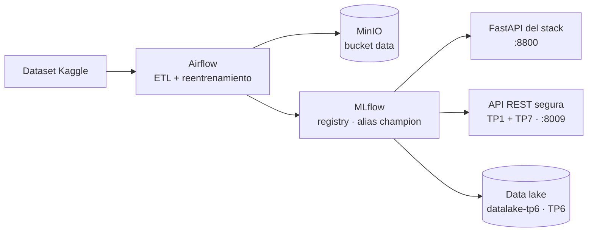
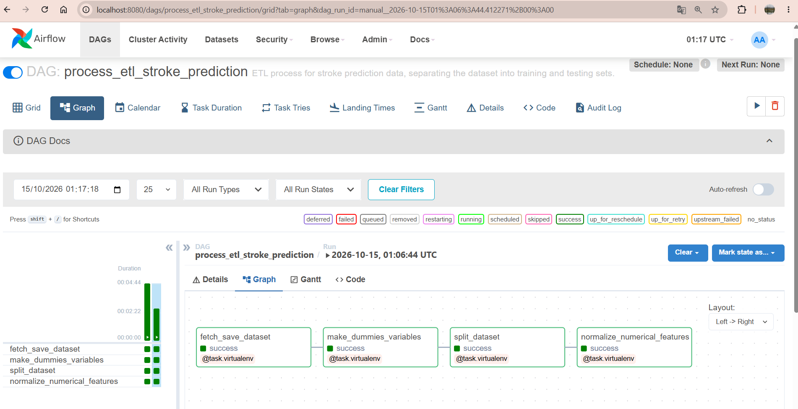
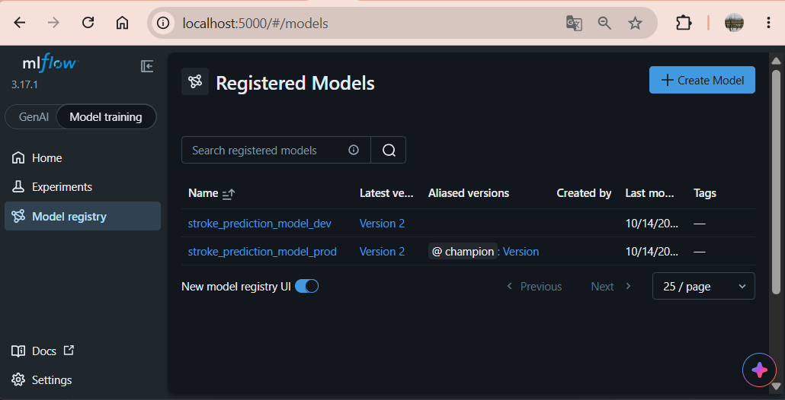
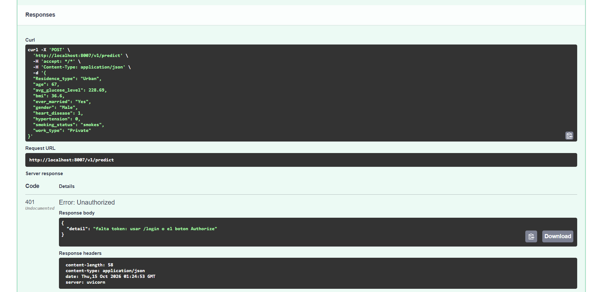
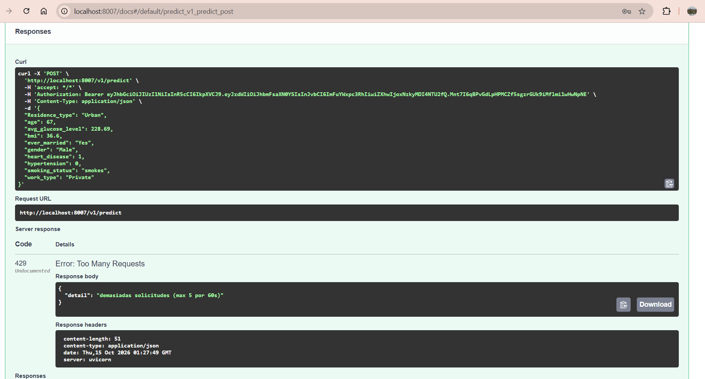

# Plataforma de predicción de riesgo de ACV - Operaciones de Aprendizaje Automático II (MIA – FIUBA)

Autora: Cecilia Villanueva · azulvillanueva@gmail.com

## Resumen

Este repositorio reúne los mini-TPs de la materia y el TP integrador. Todos parten del mismo modelo: un RandomForest que estima el riesgo de ACV (accidente cerebrovascular), entrenado en *Aprendizaje de Máquina II* con un dataset de Kaggle de unos 5.100 pacientes.

Los **mini-TPs** exploraron distintas formas de servir, entrenar y almacenar ese modelo: REST, GraphQL, gRPC, streaming, aprendizaje federado, data lake y seguridad. Como todos usan el mismo modelo y el mismo preprocesamiento (`common/`), sus resultados se pueden comparar.

El **TP integrador** lleva el modelo a producción: un stack con Airflow, MLflow, MinIO y FastAPI que orquesta el ETL y el reentrenamiento, y versiona el modelo con un esquema champion/challenger. De los mini-TPs, integra solo dos capas: la **API REST segura** (TP1 + TP7) y el **data lake versionado** (TP6).

- Mini-TPs: [mini_tps/README.md](mini_tps/README.md)
- TP integrador: [tp_integrador/README.md](tp_integrador/README.md)

### ¿Qué datos necesita el modelo?

`gender`, `age`, `hypertension`, `heart_disease`, `ever_married`, `work_type`, `Residence_type`, `avg_glucose_level`, `bmi`, `smoking_status`.
Respuesta: `stroke_predicted`, `label` y `probability` (más nombre y versión del modelo).

## Qué exploré y qué decidí integrar

| Mini-TP                                            | Qué explora                                                                     | Resultado                                                                               | ¿Integrado?                              |
| -------------------------------------------------- | -------------------------------------------------------------------------------- | --------------------------------------------------------------------------------------- | ----------------------------------------- |
| [TP1 - REST](mini_tps/tp1_rest/README.md)           | API con contrato Pydantic: `/v1/predict`, `/health`, `/v1/model`           | Respuestas 422 con el detalle de cada campo inválido                                   | **Sí**, como base de la API segura |
| [TP2 - GraphQL](mini_tps/tp2_graphql/README.md)     | El cliente pide solo los campos que necesita                                     | −59 % de bytes frente a REST pidiendo solo el F1 (111 vs 271)                          | No                                        |
| [TP3 - gRPC](mini_tps/tp3_grpc/README.md)           | Contrato `.proto`, unary y server streaming                                    | 9,3 ms vs 10,6 ms por llamada frente a REST (1,14×)                                    | No                                        |
| [TP4 - Streaming](mini_tps/tp4_streaming/README.md) | Inferencia online sobre 800 eventos, métricas por ventana y drift               | p95 global ≈ 24 ms; el drift de la edad llega a 0,32 desvíos (umbral de alerta: 0,45) | No                                        |
| [TP5 - Federado](mini_tps/tp5_federado/README.md)   | FedAvg sobre clientes con datos repartidos                                       | Accuracy 0,78 con datos IID y 0,52 con non-IID                                          | No                                        |
| [TP6 - Data lake](mini_tps/tp6_datalake/README.md)  | Zonas `raw`/`curated`/`models` con versión en MinIO; servir desde el lake | El modelo se carga desde el lake, no desde disco                                        | **Sí**                             |
| [TP7 - Seguridad](mini_tps/tp7_seguridad/README.md) | JWT con roles, validación, rate limiting, auditoría                            | 401, 403, 422 y 429 donde corresponde                                                   | **Sí**, sobre la API del TP1       |

### Por qué integré esas dos

GraphQL, gRPC, streaming y federado responden a "¿de qué otra forma podría servir o entrenar el modelo?": son alternativas, y en un sistema real se elige una según el caso. La seguridad y el data lake responden a "¿qué le falta a este sistema para estar en producción?". Un modelo que trabaja con datos de salud no puede estar expuesto sin autenticación, y los datos y los modelos tienen que guardarse versionados para poder auditar y volver atrás.

## Arquitectura del TP integrador



*Airflow entrena → MLflow elige el champion → la API segura lo sirve → el data lake guarda cada versión.*

> **Alias `champion`:** etiqueta del registry de MLflow que apunta a la versión del modelo en producción. Los servicios piden "el champion", no una versión fija; promover o revertir un modelo es mover la etiqueta.

## Cómo funciona el pipeline

Hay dos DAGs en [tp_integrador/stack/airflow/dags/](tp_integrador/stack/airflow/dags/).

**ETL - `process_etl_stroke_prediction`**

1. `fetch_save_dataset`: descarga el dataset y lo guarda en MinIO.
2. `make_dummies_variables`: variables dummy para las categóricas.
3. `split_dataset`: split estratificado **80/20** primero (el test conserva la distribución real), imputación de `bmi` con la mediana de entrenamiento y SMOTE solo sobre el entrenamiento.
4. `normalize_numerical_features`: `StandardScaler` ajustado solo con el entrenamiento y aplicado al test; la media y el desvío quedan en `data_info/data.json`.

**Reentrenamiento - `retrain_stroke_prediction_model`**

1. Clona el champion (mismo algoritmo e hiperparámetros) y lo reentrena con los datos nuevos.
2. Lo registra en MLflow como `challenger`.
3. Compara el F1 en test: lo promueve a `champion` solo si es **estrictamente mayor**; si no, descarta el alias `challenger`.

## Estructura del repositorio

```
MLOPs2_UBA_Tps/
├── README.md                    # este archivo
├── requirements.txt             # dependencias de los mini-TPs y de los servicios locales
├── common/                      # modelo compartido por mini-TPs e integrador
│   ├── train_model.py           # entrena el modelo y genera artifacts/
│   ├── inference.py             # preprocesa + predice
│   ├── mlflow_champion.py       # carga el champion de MLflow con la misma interfaz
│   ├── data/                    # dataset
│   └── artifacts/               # model.pkl y data_dict.json generados
├── mini_tps/
│   ├── README.md
│   ├── tp1_rest/                # API REST (FastAPI)
│   ├── tp2_graphql/             # GraphQL (Strawberry) + comparación con REST
│   ├── tp3_grpc/                # gRPC: .proto, servidor, cliente, comparación de latencia
│   ├── tp4_streaming/           # streaming: eventos, latencia, drift (notebook)
│   ├── tp5_federado/            # aprendizaje federado, FedAvg (notebook)
│   ├── tp6_datalake/            # data lake en MinIO + MLflow opcional (notebook)
│   ├── tp7_seguridad/           # seguridad SAIF sobre REST (notebook)
│   ├── servicios/               # levantar los mini-TPs como servicios para explorarlos
│   └── demo_todos/              # recorrido de punta a punta por todos los mini-TPs
└── tp_integrador/
    ├── README.md
    ├── stack/                   # Docker: Airflow, MLflow, MinIO, Postgres, FastAPI
    ├── api_segura/              # TP1 + TP7 sirviendo el champion
    ├── datalake/                # TP6: publica el champion en el lake
    ├── servir.bat               # levanta la API segura con el champion
    ├── parar.bat
    └── docs/                    # capturas de pantalla
```

## Cómo lo uso

Requisitos: Python ≥ 3.10 y Docker Desktop (solo para el TP integrador).

### A. TP integrador (stack Docker + API segura + data lake)

Desde `tp_integrador/stack/`:

1. Servir el dataset que descarga el DAG: `python -m http.server 12000 -d data`
2. `docker compose --profile all up -d --build` y verificar con `docker ps -a` que todo esté *healthy*.
3. En Airflow (:8080) activar y correr **`process_etl_stroke_prediction`** (deja `s3://data/final/...`).
4. Registrar el champion inicial, **solo la primera vez**:
   ```bash
   docker exec -e HOME=/tmp -e PYTHONUSERBASE=/tmp/pyu airflow_scheduler python -m pip install --user awswrangler
   docker exec -i -e PYTHONPATH=/tmp/pyu/lib/python3.8/site-packages airflow_scheduler python - < airflow/register_champion.py
   ```
5. Correr **`retrain_stroke_prediction_model`**: entrena un challenger y lo promueve si mejora el F1.

Desde la raíz del repo, con el entorno de Python activo (ver B):

```powershell
tp_integrador\servir.bat                                       # API segura con el champion, :8009
.venv\Scripts\python.exe tp_integrador\datalake\publicar_champion.py   # publica el champion en el data lake
tp_integrador\parar.bat                                        # apaga la API segura
```

Bajar el stack: `docker compose --profile all down` (agregar `-v` para borrar buckets y bases).

### B. Mini-TPs

```powershell
python -m venv .venv
.venv\Scripts\Activate.ps1
pip install -r requirements.txt
python common/train_model.py                  # genera common/artifacts/
mini_tps\servicios\servir.bat                 # REST, REST seguro, GraphQL y gRPC como servicios
mini_tps\demo_todos\demo.bat                  # recorrido completo (--rapido omite los notebooks pesados)
```

> En Windows, si el `.venv` se movió de carpeta, `activate` apunta a la ruta vieja y `python` cae en otra instalación (por ejemplo, Anaconda). Los `.bat` llaman directamente a `.venv\Scripts\python.exe` para evitarlo.

### C. Extra: API segura endurecida

`tp_integrador\api_segura\servir_endurecido.bat` levanta Redis en Docker y dos instancias de la API segura con HTTPS y rate limit compartido. Sirve el champion, así que requiere el stack arriba (A) y Docker para Redis. Detalle en [tp_integrador/README.md](tp_integrador/README.md).

## Servicios, puertos y credenciales

| Servicio                                      | URL                            | Credenciales                                                           |
| --------------------------------------------- | ------------------------------ | ---------------------------------------------------------------------- |
| Airflow                                       | http://localhost:8080          | airflow / airflow                                                      |
| MLflow                                        | http://localhost:5000          | —                                                                     |
| MinIO (consola)                               | http://localhost:9001          | minio / minio123                                                       |
| MinIO (API S3)                                | http://localhost:9000          | minio / minio123                                                       |
| FastAPI del stack                             | http://localhost:8800/docs     | —                                                                     |
| API REST segura (champion)                    | http://localhost:8009/docs     | `analista/analista123`, `admin/admin123`, `invitado/invitado123` |
| Mini-TPs: REST / REST seguro / GraphQL / gRPC | :8001 / :8007 / :8002 / :50051 | los mismos usuarios en el REST seguro                                  |
| Mini-TPs, modo champion: GraphQL / gRPC       | :8012 / :50052                 | —                                                                     |

Son credenciales de demo. El `.env` del stack está versionado porque solo contiene esas credenciales. En producción vendrían de un gestor de secretos y de un proveedor de identidad.

## Seguridad (TP1 + TP7)

| Control                                | Resultado                                                                            |
| -------------------------------------- | ------------------------------------------------------------------------------------ |
| Sin token, token expirado o manipulado | 401                                                                                  |
| Rol no permitido                       | 403                                                                                  |
| Entrada fuera de rango (Pydantic)      | 422                                                                                  |
| Ráfaga de consultas (rate limit)      | 429; frena el robo del modelo por *scraping*                                       |
| Auditoría                             | hash de la entrada (no el dato clínico), usuario, predicción y versión del modelo |
| Model card                             | `GET /v1/model-card`: uso previsto, limitaciones y métricas                       |

Pruebas sugeridas en el Swagger de la API segura: predict sin token → 401; con `analista` → 200; seis consultas seguidas → 429; con `invitado` → 403; con `admin`, `GET /v1/auditoria`.

| Captura                                             |                                                       |
| --------------------------------------------------- | ----------------------------------------------------- |
| Airflow: DAGs en verde                              | MLflow: alias `champion`                            |
|  |  |
| API segura: 401 sin token                           | API segura: 429 por rate limit                        |
|    |      |

## Verificación

| Qué comprobar            | Comando                                                                                   | Resultado esperado                                                                                 |
| ------------------------- | ----------------------------------------------------------------------------------------- | -------------------------------------------------------------------------------------------------- |
| Stack Docker              | `docker ps`                                                                             | 6 contenedores *healthy*: postgres, minio, mlflow, airflow_webserver, airflow_scheduler, fastapi |
| DAGs ejecutados           | `docker exec airflow_scheduler airflow dags list-runs -d process_etl_stroke_prediction` | última corrida en `success` (igual para `retrain_stroke_prediction_model`)                    |
| Champion registrado       | http://localhost:5000 → *Models* → `stroke_prediction_model_prod`                   | alias `champion` en una versión                                                                 |
| Datos en el lake          | http://localhost:9001 (minio / minio123)                                                  | buckets `data` y `mlflow` con objetos                                                          |
| API del stack             | `curl http://localhost:8800/`                                                           | `{"message":"Welcome to the Stroke Predictor API"}`                                              |
| API segura                | `tp_integrador\servir.bat` y abrir http://localhost:8009/docs                           | carga; `model_name` termina en `(champion MLflow)`                                             |
| Data lake                 | `.venv\Scripts\python.exe tp_integrador\datalake\publicar_champion.py`                  | publica `models/vN/` y sirve desde el lake verificando el hash                                   |
| Mini-TPs                  | `mini_tps\demo_todos\demo.bat`                                                          | `OK:` en cada notebook y `Fin:` al final                                                       |
| Servicios de los mini-TPs | `mini_tps\servicios\servir.bat` y abrir las URLs                                        | `/docs` y GraphiQL cargan                                                                        |

## Límites conocidos y próximos pasos

- **Monitoreo (próximo paso):** la alerta de drift del TP4 ya está implementada (mide el desplazamiento de la edad y alerta al superar el umbral de 0,45), pero el stack todavía no la usa. Falta conectarla para que dispare el reentrenamiento en Airflow y cierre el ciclo: detectar el cambio, reentrenar y promover solo si mejora.
- **Streaming simulado:** usa una cola en memoria; en producción iría Kafka.
- **Federado didáctico:** usa un modelo softmax porque FedAvg promedia pesos y un RandomForest no tiene pesos promediables.
- **Evaluación del modelo (corregida):** el ETL ahora separa el test antes de aplicar SMOTE (que se usa solo sobre entrenamiento), imputa `bmi` con la mediana de entrenamiento y ajusta el scaler solo con entrenamiento. Con el test en su distribución real (1.022 observaciones, unos 5 % de casos positivos), el F1 del champion bajó de ≈ 0,97 a **0,11** (accuracy 0,94, precision 0,19, recall 0,08). El 0,97 anterior estaba inflado por los casos sintéticos del test: el modelo detecta pocos casos reales de ACV. Los mini-TPs siguen reportando F1 ≈ 0,97 porque usan `common/train_model.py`, que conserva el preprocesamiento original, así que esos números no son comparables con los del champion.

## Posibles problemas

- **Postgres no arranca en Docker:** `postgres:latest` ahora es la 18 y cambió la ruta de datos. Se fijó `postgres:16` en `tp_integrador/stack/docker/postgres/Dockerfile`.
- **MLflow "unhealthy" o los DAGs no conectan:** las versiones nuevas rechazan el host `mlflow:5000`; se agregó `--allowed-hosts` y la URI `postgresql+psycopg2://` en `tp_integrador/stack/docker-compose.yaml`.
- **El DAG ETL falla al descargar el dataset:** la URL usa `host.docker.internal:12000`; el servidor `http.server` tiene que estar corriendo.
- **El DAG de reentrenamiento falla con `Registered Model ... not found`:** falta registrar el champion inicial (paso 4 de A).
- **La API segura o los servicios champion terminan con "No se pudo conectar a MLflow":** el stack no está arriba. Levantarlo, o usar `MODEL_SOURCE=local` (API segura) o los servicios de `mini_tps\servicios\servir.bat`.
- **gRPC no arranca tras instalar mlflow:** `mlflow` baja `protobuf`; reinstalar `protobuf>=7.35.1`.

## Conclusiones

Llevar un modelo a producción es decidir cómo se sirve, cómo se actualiza sin romper nada, cómo se protege y cómo se guarda. Los mini-TPs sirvieron para comparar alternativas con números: bytes en GraphQL, latencia en gRPC, el costo de no centralizar los datos en el federado. La integración se quedó con lo que un sistema real necesita sí o sí: un champion versionado que se reentrena y se promueve solo si mejora, una API protegida y un lugar donde guardar cada versión sin pisarla.
