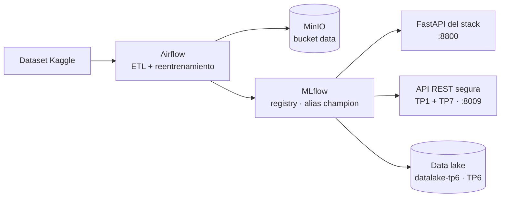

# TP integrador — Plataforma de predicción de riesgo de ACV

**Operaciones de Aprendizaje Automático II · CEIA – FIUBA** · Autora: Cecilia Villanueva

El TP integrador lleva el modelo de riesgo de ACV (accidente cerebrovascular) a producción: un **stack de producción** (Airflow + MLflow + MinIO + FastAPI en Docker, con esquema champion/challenger) más **dos capas** de los mini-TPs, elegidas porque cualquier sistema en producción las necesita:

- **API REST segura** (TP1 + TP7): sirve el champion de MLflow con JWT, roles, validación, rate limiting y auditoría.
- **Data lake versionado** (TP6): guarda cada versión del champion sin pisarla.

El resto de los mini-TPs (GraphQL, gRPC, streaming, federado) exploró alternativas sobre el mismo modelo y vive en [../mini_tps/](../mini_tps/README.md). Para el panorama completo, ver el [README general](../README.md).

## Por qué integré esas dos

GraphQL, gRPC, streaming y federado responden a "¿de qué otra forma podría servir o entrenar el modelo?": son alternativas, y en un sistema real se elige una según el caso. La seguridad y el data lake responden a "¿qué le falta a este sistema para estar en producción?". Un modelo que trabaja con datos de salud no puede estar expuesto sin autenticación, y los datos y los modelos tienen que guardarse versionados para poder auditar y volver atrás.

## Arquitectura



*Airflow entrena → MLflow elige el champion → la API segura lo sirve → el data lake guarda cada versión.*

**Alias `champion`:** etiqueta del registry de MLflow que apunta a la versión en producción. Los servicios piden "el champion", no una versión fija; promover o revertir un modelo es mover la etiqueta.

## Cómo funciona el pipeline

Dos DAGs en [stack/airflow/dags/](stack/airflow/dags/):

- **ETL (`process_etl_stroke_prediction`):** `fetch_save_dataset` → `make_dummies_variables` → `split_dataset` (split estratificado **80/20**, `bmi` imputado con la mediana de entrenamiento, SMOTE solo sobre entrenamiento) → `normalize_numerical_features` (`StandardScaler` ajustado solo con entrenamiento; media y desvío en `data_info/data.json`).
- **Reentrenamiento (`retrain_stroke_prediction_model`):** clona el champion (mismo algoritmo e hiperparámetros), lo reentrena, lo registra como `challenger` y lo promueve a `champion` solo si su F1 en test es **estrictamente mayor**.

## Cómo correrlo

Requisitos: Docker Desktop y, para la API segura y el data lake, un entorno de Python con `pip install -r requirements.txt` (ver el [README general](../README.md#b-mini-tps)).

Desde `tp_integrador/stack/`:

1. Servir el dataset que descarga el DAG: `python -m http.server 12000 -d data`
2. `docker compose --profile all up -d --build` y verificar con `docker ps -a` que todo esté *healthy*.
3. En Airflow (:8080) activar y correr **`process_etl_stroke_prediction`**.
4. Registrar el champion inicial, **solo la primera vez**:
   ```bash
   docker exec -e HOME=/tmp -e PYTHONUSERBASE=/tmp/pyu airflow_scheduler python -m pip install --user awswrangler
   docker exec -i -e PYTHONPATH=/tmp/pyu/lib/python3.8/site-packages airflow_scheduler python - < airflow/register_champion.py
   ```
5. Correr **`retrain_stroke_prediction_model`**.

Desde la raíz del repo:

```powershell
tp_integrador\servir.bat                                               # API segura con el champion, :8009
.venv\Scripts\python.exe tp_integrador\datalake\publicar_champion.py   # publica el champion en el data lake
tp_integrador\parar.bat                                                # apaga la API segura
```

### API segura

[api_segura/api_segura.py](api_segura/api_segura.py) carga el champion de MLflow por defecto y requiere el stack arriba. Si MLflow no responde, termina a los ~10 segundos con el mensaje "No se pudo conectar a MLflow en localhost:5000...". Con `MODEL_SOURCE=local` usa el modelo de `common/` sin necesidad del stack (así la usa [../mini_tps/servicios/servir.bat](../mini_tps/servicios/servir.bat) en el puerto 8007). Se reconoce el champion porque `model_name` termina en `(champion MLflow)`.

### Data lake

[datalake/publicar_champion.py](datalake/publicar_champion.py) publica el champion en `s3://datalake-tp6/models/vN/` (con `data_dict.json`, `metadata.json` y sha256), actualiza el puntero `models/champion.json` y luego sirve el modelo **desde el lake** verificando la integridad. Las versiones son inmutables: si `vN` existe, no se sobrescribe.

### Extra: versión endurecida (HTTPS + Redis)

`tp_integrador\api_segura\servir_endurecido.bat` levanta un contenedor Redis y **dos instancias** de la API segura con TLS (`https://localhost:8443/docs` y `https://localhost:8444/docs`; el navegador avisa porque el certificado es autofirmado). El contador de consultas vive en Redis, así que el límite vale para ambas instancias: con límite 5, tres consultas a una y dos a la otra agotan el cupo de las dos (la sexta da 429). Sin `REDIS_URL`, la API vuelve al contador en memoria.

> **Requiere el stack arriba** (sirve el champion) **y Docker** para Redis.

## Servicios, puertos y credenciales

| Servicio | URL | Credenciales |
| --- | --- | --- |
| Airflow | http://localhost:8080 | airflow / airflow |
| MLflow | http://localhost:5000 | — |
| MinIO (consola) | http://localhost:9001 | minio / minio123 |
| MinIO (API S3) | http://localhost:9000 | minio / minio123 |
| FastAPI del stack | http://localhost:8800/docs | — |
| API REST segura | http://localhost:8009/docs | `analista/analista123`, `admin/admin123`, `invitado/invitado123` |
| API segura endurecida (HTTPS) | https://localhost:8443/docs y :8444 | los mismos |

Son credenciales de demo. El `.env` del stack está versionado porque solo contiene esas credenciales. En producción vendrían de un gestor de secretos y de un proveedor de identidad.

## Seguridad (TP1 + TP7)

| Control | Resultado |
| --- | --- |
| Sin token, token expirado o manipulado | 401 |
| Rol no permitido | 403 |
| Entrada fuera de rango (Pydantic) | 422 |
| Ráfaga de consultas (rate limit) | 429; frena el robo del modelo por *scraping* |
| Auditoría | hash de la entrada (no el dato clínico), usuario, predicción y versión del modelo |
| Model card | `GET /v1/model-card`: uso previsto, limitaciones y métricas |

## Límites conocidos y próximos pasos

- **Monitoreo (próximo paso):** la alerta de drift del TP4 ya está implementada (mide el desplazamiento de la edad y alerta al superar el umbral de 0,45), pero el stack todavía no la usa. Falta conectarla para que dispare el reentrenamiento en Airflow y cierre el ciclo: detectar el cambio, reentrenar y promover solo si mejora.
- **Evaluación del modelo (corregida):** el ETL ahora separa el test antes de aplicar SMOTE (que se usa solo sobre entrenamiento), imputa `bmi` con la mediana de entrenamiento y ajusta el scaler solo con entrenamiento. Con el test en su distribución real (1.022 observaciones, unos 5 % de casos positivos), el F1 del champion bajó de ≈ 0,97 a **0,11** (accuracy 0,94, precision 0,19, recall 0,08). El 0,97 anterior estaba inflado por los casos sintéticos del test: el modelo detecta pocos casos reales de ACV. Los mini-TPs siguen reportando F1 ≈ 0,97 porque usan `common/train_model.py`, que conserva el preprocesamiento original, así que esos números no son comparables con los del champion.
- **Credenciales y usuarios de demo** en el código y en `.env`; en producción, gestor de secretos e identidad externa.
- **Rate limit en memoria** salvo con Redis (versión endurecida).
